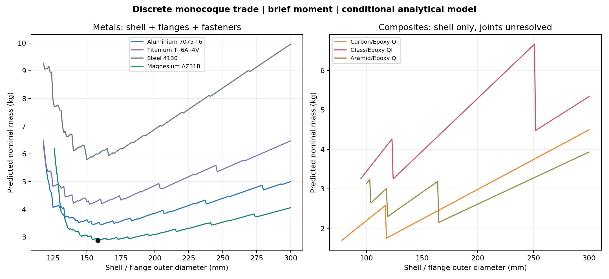
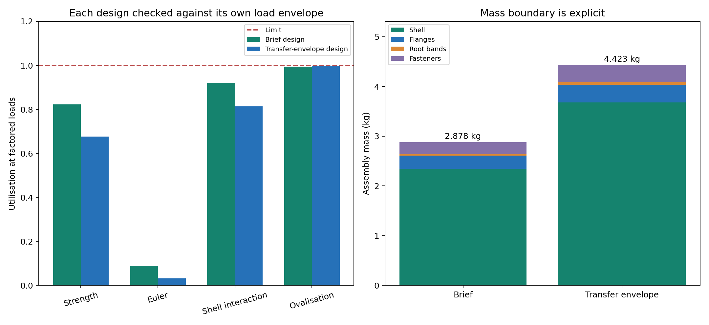
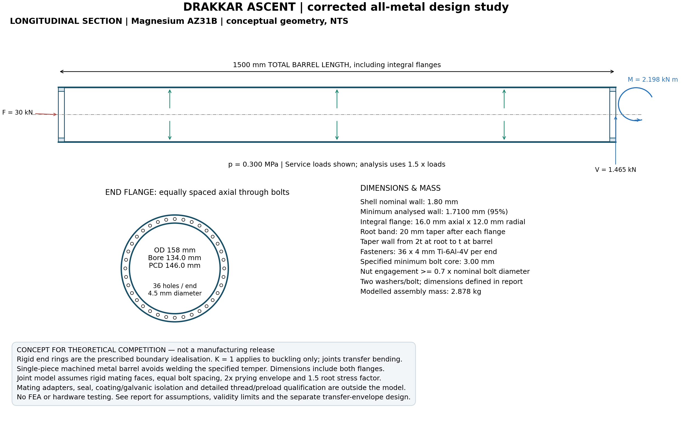
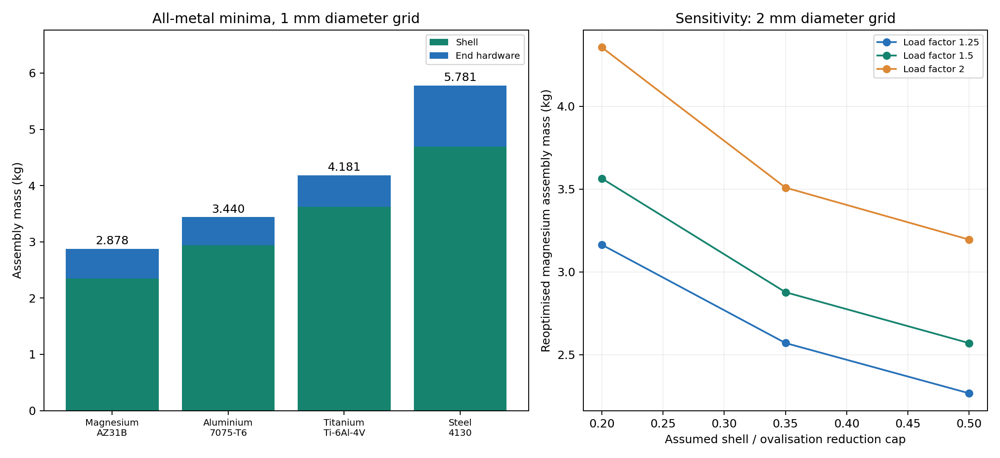

# The Drakkar Ascent Challenge — corrected analytical solution

**Status:** reproducible theoretical design study under an explicit project design basis. This replaces the unsupported passing-design and global-winner claims in research commit dd1fce2. No FEA, black-box optimiser or hardware testing is used. All equations are plain text so they remain readable without LaTeX support.

**Selected all-metal candidate:** Magnesium AZ31B, 158 mm OD, 1.80 mm nominal shell, 2.878 kg modelled assembly. It passes every IMPLEMENTED check under the following assumptions. It is the minimum of the declared discrete monocoque/flange family, not a proven minimum over all stiffened, sandwich, composite and hybrid structures.

**Material/input limits remain real:** the brief does not specify safety factors, imperfections, a composite failure equation, ply properties, joint requirements or pressure-end load transfer. The choices below complete the mathematical problem; they do not turn missing data into validated material/process properties. Joint strip/prying models, long-shell empirical extrapolation and the transverse-shear surrogate require acceptance as course-level approximations. A flight-qualified or universally optimal solution cannot be established from the supplied data alone.

## 1. Design basis and mass boundary

| Item | Adopted basis | Provenance |
|---|---|---|
| Length | 1500 mm between barrel mating faces, including its own integral flanges | Brief; explicit length convention |
| Maximum OD | 300 mm including barrel flanges | Brief |
| End restraint | Rigid circular end rings; K = 1 only for stability | Brief + user clarification |
| Axial compression | 30 kN; no helpful pressure relief in stability checks | Brief + conservative project choice |
| Load factor | 1.50 applied to F, M, V and p before nonlinear amplification | Project assumption, NOT a supplied requirement |
| Thickness used for strength/stability | 95% of nominal; mass at nominal | Project manufacturing allowance |
| Initial bow | 1.5 mm stress-free sinusoidal bow, L/1000 | Project imperfection assumption |
| Local reduction | min(geometry-dependent isotropic correlation, 0.35) | NASA correlation + project cap; composite use conditional |
| Ovalisation reduction | 0.35 times ideal Brazier capacity | Additional project assumption, NOT a NASA-prescribed KDF |
| Pressure | Wall-only, closed-end and unpressurised strength envelopes; no stabilisation credit | Resolves ambiguous load path conservatively within model |
| Diameter search domain | 40-300 mm, 1 mm increments | Computational lower boundary; 300 mm maximum from brief |
| Metal wall grid | 0.80-8.00 mm in 0.05 mm increments | Assumed machining design grid |
| Composite wall grid | 1-8 mm in 1 mm increments | Assumed 0.125 mm plies in complete 8-ply QI blocks |
| Structural family | Unstiffened uniform shell + integral inward metal end flanges | Chosen analytically tractable family |
| Mass included | Shell, flange additions, root taper additions, both bolt/nut/washer sets | Explicit calculation |
| Excluded mass | Adjacent vehicle adapters; unspecified seals, coating, isolation and fillet detail | Not zero: not specified or designed |

Reported mass is therefore **modelled structural assembly mass**, not an all-inclusive flight hardware weight. Fastener protrusions into adjacent adapters are outside the between-mating-faces length convention. If the competition uses a complete bounding-box or includes adjacent mating adapters, its geometry and mass boundary must be adjusted. No claim is made that an unspecified rigid adapter has zero physical mass.

For fabrication, use a single-piece machined/formed blank with integral ends to retain the specified parent-material properties without assuming welded-joint allowables. A 1.5 m thin shell with internal end flanges needs specialist tooling; the drawing is a concept, not a manufacturing release. Magnesium/titanium interfaces require environmental and galvanic-isolation details for a real build. No cure cycle, impact tolerance, fatigue life or thermal limit is invented.

## 2. Flight loads, derived from the brief

```text
q     = 0.5 * 1.225 * 200^2           = 24500.000 Pa
alpha = atan(20 / 200)                = 0.099668652 rad
f     = q * 2 * alpha * 0.10          = 488.376397 N/m
V     = f * 3                        = 1465.129192 N
M     = f * 3^2 / 2                  = 2197.693787 N m
F     = 30000 N, compression
p     = 300000 Pa, internal
```

The primary comparison follows the brief's instruction to use M = 2.198 kN m. A separate transfer envelope uses M + V*L = 4.395388 kN m, applicable if the upper-interface moment and shear traverse the barrel without an intermediate lateral reaction. The two are clearly separated; changing the physical moment diagram is not hidden inside the original load case.

## 3. Load transfer and exact geometry

Rigid joints transfer the moment through circumferential axial forces. Supports maintaining circularity do not erase the moment. They also do not eliminate interior ovalisation.

```text
ro = Do / 2
ri = ro - t_min
r  = (ro + ri) / 2
A  = pi * (ro^2 - ri^2)
I  = pi/4 * (ro^4 - ri^4)

Nx(theta) = -F/(2*pi*r) + M*cos(theta)/(pi*r^2) + Nx_pressure
Nx_pressure = 0                 for wall-only pressure load transfer
Nx_pressure = p*r/2             for thin-wall closed-end transfer
```

Nx has units N/m of circumference. Its bending component integrates to zero axial resultant and to the applied moment. `F + 2*M/r` is NOT used as the Euler axial load. Exact A and I are used for global beam stresses and stability; mean radius is used consistently in shell equations.

## 4. Beam-column effects and stress evaluation

All following P, M0, Vd and pd are already factored by 1.5. L remains 1.5 m even though thick end zones would increase stiffness; no fixity or end-thickening credit is taken.

```text
Pcr = pi^2 * E * I / L^2             (K = 1)
Ue  = P / Pcr                        must be < 1
u   = L * sqrt(P / (E*I))
M_design = M0 / cos(u/2) + P*e0/(1 - P/Pcr)
```

For constant first-order bending M0, solving the pinned beam-column equation gives the secant amplification `1/cos(u/2)` at midspan. The second term is the response to the assumed sinusoidal initial bow. Taking the maximum first-order moment uniformly along the span is an envelope within this beam model. Stability uses the full compressive thrust even for the closed-end pressure case.

```text
sx(theta) = -P/A + M_design*ro*cos(theta)/I + sx_pressure
sy        = pd*ro/t_min
shear(theta) = Vd*sin(theta)/(pi*r*t_min)
sx_pressure = 0 or pd*pi*ri^2/A

Metal von Mises = sqrt(sx^2 + sy^2 - sx*sy + 3*shear^2)
Metal utilisation = von_Mises / supplied_yield_strength
```

The outer-radius hoop expression upper-bounds the mean/inner-radius membrane expression. Bending uses outer-fibre stress. Stresses are evaluated at the same angle. Since squared failure measures are quadratic in cos(theta), the code checks interval endpoints and stationary points analytically, including sign-change boundaries. A dense angular scan independently tests this maximisation.

For composites only, the adopted *homogenised screening* equation is:

```text
X = supplied Xc when sx < 0; supplied Yt when sx >= 0
FI = (sx/X)^2 + (sy/Yt)^2 + abs(sx*sy)/(X*Yt) + (shear/S)^2
Composite screening utilisation = sqrt(FI)
```

Using Yt as longitudinal tensile strength assumes QI directional equivalence; the positive cross term is a project interaction envelope. Neither establishes ply-resolved first-ply failure. The drawing no longer assigns the supplied QI E and allowables to a nine-ply non-QI schedule.

## 5. Local buckling, shear and ovalisation

The local model uses independent axial and bending capacities with a linear interaction, and caps any elastic stress capacity at the available material strength.

```text
phi = sqrt(r/t_min) / 16
gx = min(0.35, 1 - 0.901*(1 - exp(-phi)))
gb = min(0.35, 1 - 0.731*(1 - exp(-phi)))
classical_stress = E/sqrt(3*(1-nu^2)) * t_min/r
sx_cr = min(gx*classical_stress, normal_material_limit)
sb_cr = min(gb*classical_stress, normal_material_limit)

shear_cr = 0.747 * 0.67 * E * (t_min/r)^1.25 / sqrt(L/r)
shear_cr is also capped by material shear strength.

Ulocal = (P/A)/sx_cr
       + (M_design*ro/I)/sb_cr
       + [Vd/(pi*r*t_min)]/shear_cr

M_Brazier_ideal = 0.987 * E*r*t_min^2 / sqrt(1-nu^2)
Uoval = M_design / (0.35 * M_Brazier_ideal)
```

Pass each implemented limit at utilisation <= 1, before rounding. End circularity does not justify deleting the ovalisation check. Internal pressure stabilisation is deliberately not credited.

**Applicability limits:** the moderately-long-cylinder shear formula's dimensionless range is checked in code, and thin shells are restricted to 10 <= r/t < 1500. Replacing nonuniform transverse shear by its peak as uniform torsional shear is a screening surrogate; it is not a demonstrated rigorous lower bound for every transverse-shear buckling mode. Likewise the combined local/global/ovalisation modelling is an analytical approximation, not a coupled nonlinear shell solution. The long-shell extrapolation and composite stiffness assumptions remain stated limitations, even when numerical utilisations pass. The report does not describe 0.35 as a universally validated NASA factor.

## 6. End connection and mass model

The all-metal design uses integral inward annular flanges and equally spaced axial through bolts. Mating faces are treated as rigid, as required by the brief. Bolt material is the supplied Ti-6Al-4V (880 MPa yield, 4430 kg/m^3); no commercial bolt grade or thread standard is assumed from that designation alone.

```text
Candidate bolt diameters d = 4, 5, 6, 8, 10 mm
Candidate bolts/end n = every integer count from 8 through 64
Radial flange width w = 3*d through 4*d in 0.25*d increments
Bolt circle radius rb = ro - w/2
Hole diameter dh = d + 0.5 mm
Circumferential strip pitch = 2*pi*rb/n
Actual adjacent-hole chord = 2*rb*sin(pi/n) >= 3*d
Radial bolt-centre edge distance = w/2 >= 1.5*d
Flange thickness = 4-30 mm in 0.5 mm increments
Minimum flange thickness for checks = 0.95 * nominal

Pressure end force Pe = pd*pi*ri^2
Bolt tension envelope T = 2 * [Pe/n + 2*M_design/(n*rb)]
Bolt shear envelope Q = 2*Vd/n
Bolt minimum core area = pi*(0.75*d)^2/4
Bolt utilisation = sqrt((T/core_area)^2 + 3*(Q/core_area)^2)/880 MPa
```

Thrust compression is not credited as helpful bolt clamping; full pressure-end tension is included. Factor 2 on tension is an assumed prying envelope, not a solved contact/preload model. Compression-side flange demand is also checked using P/n + 2*M/(n*rb). A radial cantilever-strip calculation uses net ligament `pitch-dh`, lever arm `ro-rb`, bending stress `6*force*lever/(ligament*t_flange_min^2)` and transverse shear `force/(ligament*t_flange_min)`. A further assumed root factor 1.5 multiplies the resulting equivalent stress.

The 1.5*d minimum radial centre-to-edge distance is a project geometry assumption. A 2.2*d-OD washer fits on every searched flange; the minimum remaining radial material beyond the hole is (w-dh)/2. Chord spacing, rather than arc length, governs adjacent-hole separation. Narrower rings reduce the stiffness indicator, so numerical strength and mass improvements do not independently validate the rigid-ring idealisation.

Additional checks cover hole bearing from transverse shear, washer contact bearing, flange punching shear and approximate thread stripping. Nut engagement is specified as at least 0.7*d; the simplified stripping area is half the cylindrical area at minimum core diameter. These checks do not establish preload retention, fatigue, detailed thread contact, flange contact behaviour or elastic ring ovality. The relative ring/shell stiffness indicator is reported only as an indicator, not a proof that a finite ring is perfectly rigid.

Nominal mass integrates exact annular shell/flange volumes, ignoring hole removal conservatively. Each flange has an additional 20 mm root band tapering from 2t to t; its mass uses a slightly conservative mean-thickness approximation. Bolt mass uses a full-diameter shank through two matching flanges plus 4 mm grip allowance, two equivalent 1.8d-diameter x 0.7d head/nut volumes, and two 2.2d-OD x 0.2d washers. Both end bolt sets are included. Mating adapter mass is excluded. No unspecified joint is silently assigned zero mass.

## 7. Discrete optimisation and selected design

All seven materials are checked. At every diameter the metal search continues above the minimum feasible shell thickness: a thicker wall can reduce amplified moment and joint mass. It stops only when increasing shell mass alone exceeds the best assembly mass at that diameter. The joint grid is searched for each candidate. This avoids assuming minimum shell thickness necessarily minimises total assembly mass.

| Metal | OD (mm) | Nominal wall (mm) | Shell (kg) | Modelled assembly (kg) |
| --- | --- | --- | --- | --- |
| Magnesium AZ31B | 158 | 1.80 | 2.345 | 2.878 |
| Aluminium 7075-T6 | 160 | 1.40 | 2.940 | 3.440 |
| Titanium Ti-6Al-4V | 152 | 1.15 | 3.621 | 4.181 |
| Steel 4130 | 150 | 0.85 | 4.690 | 5.781 |

Composite candidates remain separate because adhesive, bearing, interlaminar and connection properties are absent:

| Composite | OD (mm) | Nominal wall (mm) | Shell (kg) | Interface status |
| --- | --- | --- | --- | --- |
| Carbon/Epoxy QI | 78 | 3.00 | 1.696 | Joint mass unknown |
| Aramid/Epoxy QI | 165 | 2.00 | 2.151 | Joint mass unknown |
| Glass/Epoxy QI | 124 | 3.00 | 3.250 | Joint mass unknown |

An 8-ply `[0/+45/-45/90]s` block is symmetric and in-plane QI for identical plies; repeated blocks give the assumed 1 mm increments. This is an orientation/thickness convention only. Actual axial and bending stiffnesses and allowables still require a selected material system and lamination analysis. Stiffened and sandwich designs are permitted by the brief but not declared inferior without a comparable panel/core/interface analysis.



### Selected all-metal dimensions

- Material: **Magnesium AZ31B**.
- OD: **158 mm**; nominal shell ID: **154.40 mm**.
- Nominal shell wall: **1.80 mm**; analysed minimum: **1.7100 mm**.
- Length: **1500 mm between mating faces**, including integral flanges.
- Each flange: **16.0 mm axial thickness**, **12.0 mm radial width**; bore **134.0 mm**.
- Each end: **36 x 4 mm Ti-6Al-4V fasteners**, holes **4.5 mm**, bolt circle **146.0 mm**.
- Ring/shell relative stiffness indicator: **348.9**, informational only.

| Included item | Nominal mass (kg) |
| --- | --- |
| Shell baseline | 2.345135 |
| Two integral flange additions | 0.261721 |
| Two root taper additions | 0.030728 |
| Both sets of bolts, nuts and washers | 0.239941 |
| TOTAL MODELLED | 2.877525 |

### Recalculated design-state checks

```text
Factored compression = 45.000000 kN
Factored shear       = 2.197694 kN
Factored pressure    = 0.450000 MPa
First-order M        = 3.296541 kN m
Amplified M + bow    = 3.768540 kN m
Euler capacity      = 506.094126 kN
Worst strength case = wall_only, theta = 180.000 deg
Axial stress there  = -169.714119 MPa
Hoop stress there   = 20.789474 MPa
Local ratios        = compression 0.252316, bending 0.546647, shear 0.121001
Bolt tension bound  = 6.205158 kN per bolt
Bolt shear bound    = 0.122094 kN per bolt
```

| Check | Utilisation at design load | Margin (capacity/demand - 1) |
| --- | --- | --- |
| strength | 0.822757 | +0.215426 |
| Euler | 0.088916 | +10.246536 |
| shell_interaction | 0.919964 | +0.086999 |
| ovalisation | 0.993815 | +0.006224 |
| Joint: bolt | 0.998136 | +0.001867 |
| Joint: flange | 0.991037 | +0.009044 |
| Joint: washer_bearing | 0.627943 | +0.592501 |
| Joint: thread_strip | 0.925618 | +0.080360 |
| Joint: bearing | 0.008114 | +122.249199 |
| Joint: pullthrough | 0.142090 | +6.037772 |

These are capacity/demand margins at the factored state, not exact nonlinear proportional-load reserve factors. A small positive value is not rounded to manufacture an extra margin; 5% thickness reduction is already included. Model uncertainty is addressed by the explicit sensitivity study, not hidden inside displayed precision.





## 8. Larger moment-transfer envelope

If the bottom barrel section must carry M + V*L rather than the assignment's prescribed M, use the separate design:

| Item | Transfer-envelope result |
| --- | --- |
| Material | Magnesium AZ31B |
| OD / nominal wall | 212 / 2.10 mm |
| Modelled assembly mass | 4.423218 kg |
| Flange thickness | 16.5 mm |
| Bolts per end | 50 x 4 mm Ti-6Al-4V |
| Bolt circle | 200.0 mm |
| Governing shell check | ovalisation |

All associated details and margins are in `results/design.json` under `transfer_selected`; its diameter sweep is in `results/transfer_trade_study.csv`. The primary drawing shows only the brief-moment design. Do not combine one design's wall with the other's load or mass.

## 9. Sensitivity and what the results actually establish

| Load factor | Reduction cap | Reoptimised OD (mm) | Wall (mm) | Assembly (kg) | Original selected shell utilisation |
| --- | --- | --- | --- | --- | --- |
| 1.25 | 0.20 | 146 | 2.25 | 3.164 | 1.421 |
| 1.25 | 0.35 | 150 | 1.70 | 2.571 | 0.812 |
| 1.25 | 0.50 | 164 | 1.35 | 2.267 | 0.735 |
| 1.50 | 0.20 | 154 | 2.40 | 3.564 | 1.739 |
| 1.50 | 0.35 | 158 | 1.80 | 2.878 | 0.994 |
| 1.50 | 0.50 | 174 | 1.45 | 2.570 | 0.892 |
| 2.00 | 0.20 | 178 | 2.55 | 4.355 | 2.413 |
| 2.00 | 0.35 | 178 | 1.95 | 3.509 | 1.379 |
| 2.00 | 0.50 | 190 | 1.65 | 3.195 | 1.219 |

Sensitivity reoptimises the selected metal at 2 mm diameter spacing. Its central point can differ slightly from the primary 1 mm search. A reduction cap of 0.20 requires a heavier design; the baseline is NOT claimed to pass every alternative assumption.

The full assembly search now covers 40-300 mm, removing the earlier assumed 100 mm no-necking restriction. Joint geometry searches every integer bolt count and five flange widths. Dimensions below 40 mm, other bolt sizes, other wall grids and other structural families are not covered; this is not an unrestricted global optimum. Unknown composite interface mass and properties prevent a fair full-assembly ranking. The carbon shell's allowable interface-mass budget to beat the selected metal is **1.181 kg**, but a light joint still needs a valid strength/stability model.



## 10. Improvement achieved and remaining design space

The previous, narrower search used a minimum diameter of 100 mm, only nine bolt counts and flange width fixed at 4*d. Its primary assembly weighed 3.113879737 kg and its transfer-envelope assembly weighed 4.738748920 kg. With the SAME load factor, thickness allowance, bow, buckling reduction and joint stress assumptions, the expanded search gives:

| Case | Previous modelled mass (kg) | Expanded search (kg) | Reduction |
| --- | --- | --- | --- |
| Brief moment | 3.113880 | 2.877525 | 7.59% |
| Transfer envelope | 4.738749 | 4.423218 | 6.66% |

This comparison measures a geometric search improvement, not an independently validated increase in structural performance. The smaller flange remains conditional on the prescribed rigid-ring boundary and the documented joint approximations.

| Possible further improvement | What must be established before ranking it |
|---|---|
| Ring/stringer stiffened metal barrel | Skin panel compression/shear buckling, stringer local buckling/crippling and column failure, overall stiffened-shell instability, ring stiffness, eccentricity and all added mass |
| Composite shell with metal end inserts | Actual laminate stiffness and allowables, load transfer, bearing/interlaminar/bond stresses, insert and attachment mass |
| Sandwich shell | Core shear, face wrinkling, face/core bond and end inserts; supplied data do not define a core |
| Different safety/imperfection factors | An accepted design basis; reducing an assumed factor is not a geometric optimisation gain |
| Finer continuous dimensions | Manufacturing tolerances and meaningful practical increments; the current winner is a discrete-grid result |

[NASA TM-108399](https://ntrs.nasa.gov/citations/19930013915) provides analytical methods for stiffened cylinders, including overall instability, stringer failures and skin buckling. Adding ribs and checking only the skin panel would omit failure modes addressed by that reference. No stiffened result has been implemented or ruled out by this study.

The recommended course candidate is the minimum of the implemented family for the prescribed brief loads. If the actual barrel must transmit the larger bottom-section moment, select the separately sized transfer candidate. Neither candidate is labelled the absolute best architecture: the missing interface properties and unchecked structural families prevent that conclusion.

## 11. Reproduction and verification

```sh
python3 parametric_diameter_study.py
python3 -m unittest discover -s tests -v
python3 -m venv .venv
.venv/bin/python -m pip install -r requirements.txt
.venv/bin/python plot_trade_studies.py
.venv/bin/python generate_engineering_drawing.py
python3 generate_report.py
.venv/bin/python generate_outputs.py
```

The analysis and tests use only the Python standard library. Graphics use the pinned dependencies. All paths are relative to the script location; outputs go to `results/` and `assets/`. Importing modules does not generate files or print results. JSON is the numerical source for the reports and drawing; plots read JSON/CSV rather than duplicate equations.

Verification includes load derivation, exact annular section numbers, zero-load and quarter-Euler secant limits, rejection of the Euler singularity, zero axial resultant under pure bending, angular-extremum comparison against a dense independent scan, rejection of the old 1.4 mm proposal, tolerance effects, both moment envelopes, explicit unresolved composite joints, manufacturing grids, mass closure, physical hole/washer clearance, discrete bolt-group force/moment equilibrium and rechecking selected margins. Passing software tests establishes implementation consistency, not experimental validation of the engineering assumptions.

## 12. Sources and remaining acceptance decisions

[1] Challenge PDF in this repository: sections 3-7 (loads, materials, methods and end conditions). The user supplied the clarification that K = 1 is the buckling idealisation while real joints transmit moment.

[2] [NASA SP-8007 Rev 2](https://ntrs.nasa.gov/citations/20205011530), printed pp. 23-26 and 29-32: axial/bending shell buckling, cross-section collapse and shear/combined-load guidance. The report warns that the empirical axial correlation is not experimentally verified for L/r > 5. Every candidate here exceeds that ratio. Consequently this is a classroom extrapolation with a stated reduction cap, not a validated NASA design.

[3] [Air Force Stress Analysis Manual, beam columns](https://engineeringlibrary.org/reference/beam-columns-air-force-stress-manual): axial force and bending are separate actions; geometric amplification is included explicitly. The uniform-moment secant expression used here is derived below.

[4] [NASA composite knockdown bulletin](https://ntrs.nasa.gov/citations/20240000391): a universal composite knockdown is not justified simply by citing SP-8007. Composite results in this report are conditional equivalent-material screens.

[5] [NASA MAC/GMC laminate examples](https://nasa-multiscale.github.io/legacy/MAC-GMC-4.0-Example-Manual-12.html): quasi-isotropic in-plane properties depend on the orientation distribution. A symmetric balanced laminate is not automatically isotropic in bending.

Before presenting this as the final course submission, attach the instructor's accepted factors, moment convention and treatment of composite allowables to the stated basis. No user confirmation was required to complete this theoretical study: conservative scenarios and explicit assumptions were used. If actual joint qualification or material data become available, replace the provisional joint/laminate models and regenerate the results. No physical build or equipment operation is authorised or performed by this work.
