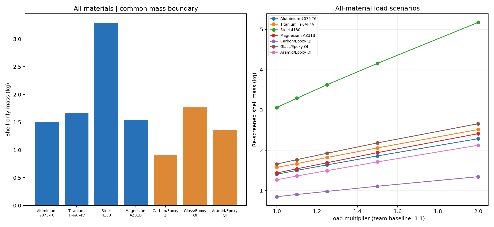
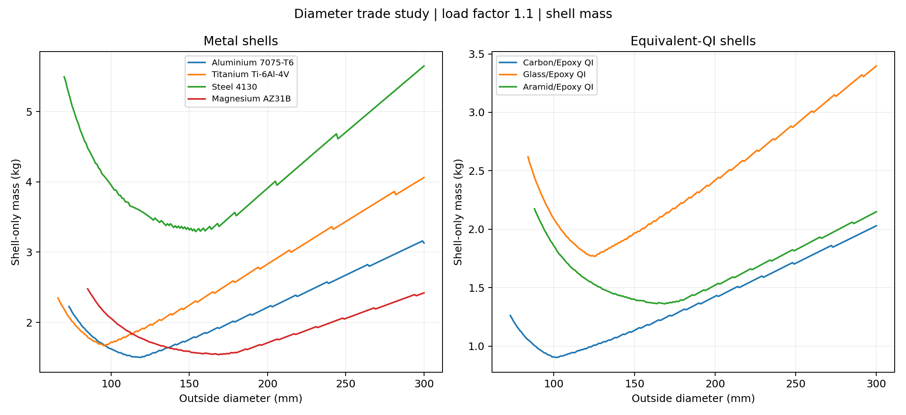
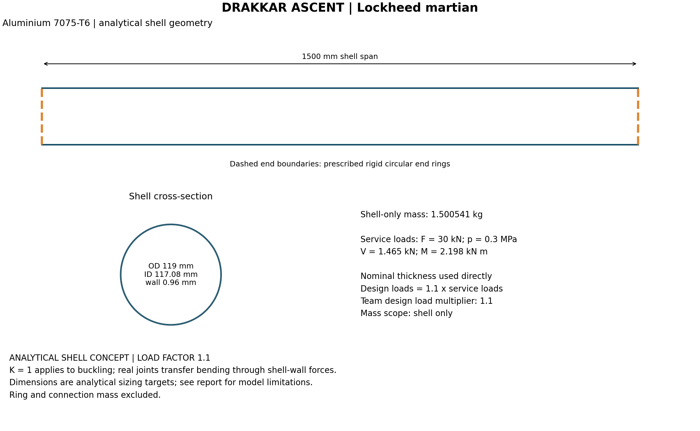

# PROJECT REPORT - Lockheed martian

**THE DRAKKAR ASCENT CHALLENGE**

Aircraft Structures Course Assignment | VJTI Mumbai | R5ME3203T

| Team member | Roll number |
|---|---|
| Aryan Vyapari | 241030078 |
| Ashutosh Yadav | 241030079 |
| Rishiraj Rajgore | 241030067 |
| Archit More | 241030057 |

## 1. Introduction

This study sizes a cylindrical thrust barrel under engine compression, gust-induced bending and shear, and internal pressure. The objective is minimum shell mass within a 1500 mm length and 300 mm maximum outside diameter. Seven supplied metallic and quasi-isotropic composite materials are compared using analytical calculations and a Python parametric search. No finite element analysis is used.

The selected metal candidate is **Aluminium 7075-T6, 119 mm outside diameter and 0.96 mm wall**, with a calculated shell mass of **1.500541 kg** at the team-selected load factor of 1.1. Results are conditional on the local-buckling approximations stated in Section 5.

## 2. Design basis and loads

### 2.1 Prescribed conditions

The brief specifies F = 30 kN, p = 0.3 MPa, length 1500 mm and maximum OD 300 mm. Rigid end rings maintain circular end sections. K = 1 is used for Euler buckling; bending is carried by axial shell-wall stresses and transferred through the end joints. Material properties are taken directly from the assignment [1].

### 2.2 Modelling assumptions

- Apply a team-selected factor of 1.1 once to F, M, V and p before analysis.
- Use a uniform nominal wall and a pinned beam-column moment envelope.
- Include pressure in strength; take no beneficial pressure-stabilisation credit in buckling.
- Use the supplied effective QI properties with a diagonal quadratic failure criterion and equal directional tensile allowable Yt.
- Report shell mass; end-ring and connection mass is outside the numerical model.

The two additional local-buckling approximations are defined with their equations in Section 3.3. The 0.01 mm thickness increment is search resolution, not a manufacturing tolerance.

### 2.3 Gust-load calculation

```text
q = 0.5 * 1.225 * 200^2 = 24500 Pa
alpha = atan(20/200) = 0.099668652 rad
f = q * 2 * alpha * 0.10 = 488.376397 N/m
V = f * 3 = 1465.129192 N
M = f * 3^2 / 2 = 2197.693787 N m
```

| Load | Service value | Design value (1.1 x) |
| --- | --- | --- |
| Compression F | 30.000 kN | 33.000 kN |
| Bending moment M | 2.197694 kN m | 2.417463 kN m |
| Transverse shear V | 1.465129 kN | 1.611642 kN |
| Wall pressure p | 0.300 MPa | 0.330 MPa |

The design moment above is the first-order value. A separate load-transfer scenario evaluates M + V*L; it is not added to the prescribed primary moment case.

## 3. Analytical methodology

### 3.1 Section geometry and beam-column response

For outside diameter D, wall t, mean radius r and length L:

```text
ro = D/2; ri = ro-t; r = (ro+ri)/2
A = pi*(ro^2-ri^2)
I = pi/4*(ro^4-ri^4)
m = density*A*L
Pcr = pi^2*E*I/L^2
M_design = M / cos[0.5*L*sqrt(F/(E*I))]
```

The secant solution accounts for compression-induced bending amplification under the assumed uniform first-order moment envelope [3]. Candidates with F >= Pcr are rejected. This response idealisation is additional to the prescribed K = 1 buckling condition.

### 3.2 Material strength

At circumferential angle theta, all stress components are evaluated at the same location:

```text
sx = -F/A + M_design*ro*cos(theta)/I
sy = p*ro/t
tau = V*sin(theta)/(pi*r*t)
Metal U = sqrt(sx^2 + sy^2 - sx*sy + 3*tau^2)/yield
Composite FI = (sx/X)^2 + (sy/Yt)^2 + (tau/S)^2
X = Xc in compression; X = Yt in tension
Composite U = sqrt(FI)
```

Von Mises is used for metals as required by the brief. The composite equation is an equivalent-QI comparison model, not a ply-resolved laminate analysis. The angular maximum is calculated analytically and independently checked by sampling.

### 3.3 Local buckling and ovalisation

NASA SP-8007 supplies the geometric knockdown correlations and ideal Brazier expression [2]:

```text
phi = sqrt(r/t)/16
gx = 1-0.901*(1-exp(-phi))
gb = 1-0.731*(1-exp(-phi))
s_classical = E*(t/r)/sqrt(3*(1-nu^2))
sx_cr = min(gx*s_classical, normal_strength)
sb_cr = min(gb*s_classical, normal_strength)
tau_cr = 0.747*0.67*E*(t/r)^1.25/sqrt(L/r)
Ulocal = (F/A)/sx_cr + (M_design*ro/I)/sb_cr
       + [V/(pi*r*t)]/tau_cr
M_Brazier = 0.987*E*r*t^2/sqrt(1-nu^2)
Uoval = M_design/M_Brazier
```

Two course-model approximations are used: normal buckling capacities are capped at material strength, and peak transverse shear is compared with a torsional-shell capacity in a linear interaction. These extensions are not established by the NASA equations. Shear capacity is also capped at yield/sqrt(3) for metals or S for QI materials. The torsion-formula range and 10 <= r/t < 1500 are checked.

### 3.4 Optimisation procedure

Python evaluates diameters from 1 to 300 mm in 1 mm increments and walls in 0.01 mm increments. At each diameter it retains the first wall satisfying all implemented utilisation limits U <= 1, then selects the lowest shell mass. The same grid and mass boundary apply to every material. This is a grid optimum within the declared model.

## 4. Results

### 4.1 Material comparison

| Material | OD (mm) | Wall (mm) | Shell mass (kg) |
| --- | --- | --- | --- |
| Aluminium 7075-T6 | 119 | 0.96 | 1.500541 |
| Titanium Ti-6Al-4V | 96 | 0.84 | 1.668701 |
| Steel 4130 | 154 | 0.58 | 3.291704 |
| Magnesium AZ31B | 169 | 1.10 | 1.540486 |
| Carbon/Epoxy QI | 101 | 1.20 | 0.902969 |
| Glass/Epoxy QI | 125 | 1.60 | 1.767787 |
| Aramid/Epoxy QI | 169 | 1.23 | 1.361409 |

Carbon/epoxy gives the lowest equivalent-QI mass. Aluminium gives the lowest metallic mass and is the worked metal candidate; the composite result remains dependent on its assumed failure interaction and laminate construction.



Figure 1. Material comparison and re-optimised mass at different load multipliers. The adopted factor is 1.1; other factors are sensitivity cases.

### 4.2 Selected aluminium calculation

Using N, mm and MPa throughout:

```text
D = 119; t = 0.96; Di = 117.08; r = 59.020
E = 71700; nu = 0.33; yield = 503 MPa
A = pi*t*(D-t) = 356.000253 mm^2
I = A*(D^2+Di^2)/16 = 620079.602999 mm^4
m = A*1500*2810/10^9 = 1.500541 kg
Pcr = 195022.100 N
Moment amplification = 1.252495
M_design = 3027860.298 N mm
Axial compression F/A = 92.696563 MPa
Bending stress M_design*ro/I = 290.539613 MPa
Hoop stress p*ro/t = 20.453125 MPa
Peak transverse shear = 9.054163 MPa
Maximum von Mises stress = 393.861238 MPa
Axial buckling capacity = 464.314936 MPa
Bending buckling capacity (capped) = 503.000000 MPa
Shear surrogate capacity = 41.348387 MPa
Ulocal = 0.199642 + 0.577614 + 0.218973
       = 0.996228
M_Brazier = 4077.695179 N m
```

| Check | Utilisation at 1.1 x loads | Numerical result |
| --- | --- | --- |
| Strength | 0.783024 | Within model limit |
| Euler | 0.169212 | Within model limit |
| Shell Interaction | 0.996228 | Within model limit |
| Ovalisation | 0.742542 | Within model limit |

Local buckling governs the numerical selection. These ratios include the 1.1 load factor already; they are not independent proportional-load safety factors.

### 4.3 Diameter trade and load transfer



Figure 2. Diameter versus minimum screened shell mass for each material.

The separate M + V*L case selects Aluminium 7075-T6, 137 mm OD x 1.10 mm wall, with shell mass 1.979519 kg. Both moment cases and all seven materials are recorded in the supplied results.

### 4.4 Concept and manufacture



Figure 3. Selected shell geometry and prescribed end-ring boundaries.

The geometry defines an analytical sizing target. Stock thickness, forming route and joint details must be established before a manufacturing specification or assembly mass is assigned.

## 5. Verification and limitations

The independent audit uses N/mm/MPa calculations, 7,200 circumferential samples and a Fourier-series beam solution. It reproduces 14 detailed candidates and 35 load-scenario cases, including overlapping cases. The maximum relative beam-moment discrepancy is 1.56e-11. The saved CSV minima agree with the selected JSON results, and all 16 unit tests pass. Full substitutions for all materials accompany the submission in docs/CALCULATION_VERIFICATION.md.

The principal limitations are the yield-capped elastic buckling capacities and transverse-shear surrogate, neither of which is a validated inelastic or combined-load solution. The axial correlation is extrapolated beyond L/r = 5, and the ideal ovalisation check does not model finite-length end-ring restraint. These limits, together with the QI approximation and excluded joint mass, make the result a conditional shell-sizing study rather than a verified total-structure optimum. NASA's plasticity treatment requires additional material data; the Air Force manual distinguishes transverse shear from torsion [2, 4].

## 6. Conclusion

At a design load factor of 1.1, the declared analytical search selects a 1.501 kg aluminium shell with 119 mm OD and 0.96 mm wall. The study supplies reproducible calculations, material comparisons and load sensitivities. The selected dimensions satisfy the implemented checks subject to the limitations in Section 5.

## 7. Code and reproduction

The submission includes raw optimisation, verification, plotting and report-generation scripts, together with CSV/JSON outputs and pinned dependencies. Python 3.10 or later is required.

```sh
python3 -m venv .venv
.venv/bin/python -m pip install -r requirements.txt
.venv/bin/python parametric_diameter_study.py
.venv/bin/python verify_calculations.py
.venv/bin/python -m unittest discover -s tests -v
.venv/bin/python plot_trade_studies.py
.venv/bin/python generate_engineering_drawing.py
.venv/bin/python generate_report.py
.venv/bin/python generate_outputs.py
```

## References

[1] The Drakkar Ascent Challenge, VJTI, August 2026, sections 3-8; supplied clarification on end conditions and load transfer.

[2] [NASA SP-8007-2020/Rev. 2, Buckling of Thin-Walled Circular Cylinders](https://ntrs.nasa.gov/citations/20205011530). Geometric knockdowns, plasticity discussion, torsion and ovalisation.

[3] [Air Force Stress Analysis Manual: Beam-Columns](https://engineeringlibrary.org/reference/beam-columns-air-force-stress-manual). Analytical compression and bending response.

[4] [Air Force Stress Analysis Manual: Simple Thin Pressure Vessels](https://engineeringlibrary.org/reference/simple-thin-pressure-vessels-air-force-stress-manual), section 8.3.1.5 and Table 8-5. Combined-load definitions and interactions.
